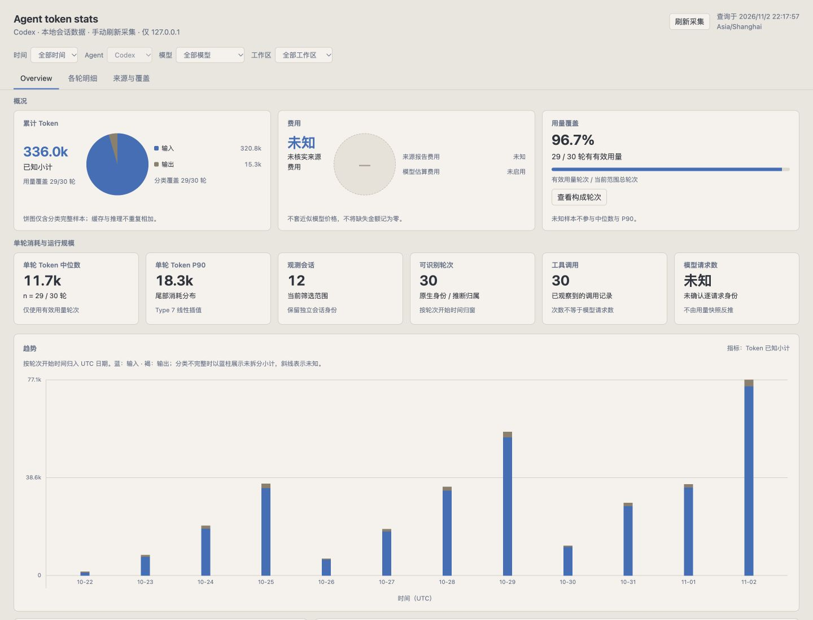

# Codex 首版验收记录

日期：2026-11-02。Python 3.9.6，Node.js 24；后端使用 Python 标准库，前端为 React 19 + TypeScript + Vite。优化比对根据用户要求未实施，不列为完成项。

## 自动验证

场景编号沿用原仓库的历史行为验收场景（该历史资料未包含在本副本）；以下记录仅表示历史验证，当前项目验证见[验证记录](../../../docs/VALIDATION.md)。

命令：`python3 -m unittest discover -s tests -v`，14 项通过；React 前端的 `npm --prefix frontend run build`（含严格 TypeScript 检查）及 `format:check` 通过。HTTP 测试验证构建入口、带哈希 JS/CSS 的返回与静态资源路径边界。

| 场景 | 已验证行为 |
| --- | --- |
| D01–D06 | 输入/输出或显式总计、零与未知、部分覆盖、重复快照与重复导入、迟到补报、重启后持久化 |
| D09–D10 | 不制造逐请求明细，跨实例身份不碰撞 |
| C04–C05 | 费用未知、不套近似费率；缓存/推理分类不重复加入总量 |
| R03–R04、R06 | 父子联合总量未知、工具只保留字节规模、不可可靠归属保留单列记录与说明 |
| A03、A08–A09 | 半开时间窗、时区偏移归一、详情保持模型范围、有效样本与 type 7 分位数 |
| O03–O06 | 损坏 JSONL/数据库记录不拖垮剩余查询、错误可见、敏感正文不入库、回环绑定、Host/Origin 拒绝、静态路径白名单 |

额外验证：历史副本不能仅凭文件 mtime 覆盖较新事件修订；分类缺失在同轮次可补报，跨轮次不强行分配；`token_usage_record` 与 `token_count` 不双计；SQLite HTTP 跨线程查询；刷新接口不能通过请求体换采集路径。

未实现的验收项：报告/估算/跨币种费用、精确模型请求身份、可确认父子包含关系的联合聚合、诊断命中率、优化 marker CRUD/比较。不能把这些场景视作全部验收通过。并发导入通过 SQLite 写锁串行修订检查；尚未做大数据量压力测试或磁盘故障注入。

## 实际接入检查

两份本机日志做过白名单结构核实，自报版本 `0.166.0-alpha.5.1`。另在临时数据库执行两文件导入与查询烟测：导入 2 个会话、7 个可识别轮次、7 个有效用量样本，解析错误/警告均为 0。只输出计数，未复制真实日志、身份或正文；临时数据库随测试清理。该小样本验证不代表覆盖所有 Codex 版本。

## 界面检查

浏览器使用合成数据，验证 React 总览、全部时间、模型/工作区筛选、轮次与会话单位切换、排序、居中详情与 Escape 关闭、来源说明。刷新期间切换筛选正确返回空状态，恢复后轮次/会话计数吻合。按旧截图的 1440 × 1100 视口核对米灰背景、顶部导航、蓝色构成图与紧凑表格；390px 窄屏无整页横向溢出。全量合成数据为 12 会话、30 轮，已知 Token 小计 336,000，覆盖 29/30 轮；中位数 11,680、P90 18,304。未知轮次未以零参与分位数。

开发服务器代理检查：`127.0.0.1:5173/api/capabilities` 返回 200；携带本地开发 Origin 的无效 JSON 刷新请求返回 400；恶意 Origin 返回 403，未执行真实采集。生产看板继续由 Python/launchd 托管，不依赖 Vite 常驻进程。

## 安装与交付

支持直接 `python3 -m agent_stats`；wheel 使用离线 `pip wheel --no-build-isolation --no-deps .` 构建，包名与版本为 `agent-stats-local 0.1.0`。已安装到临时目录，在项目目录之外用 `python3 -S -m agent_stats --help` 验证入口。打包配置包含 React 的入口和嵌套哈希资源。临时测试服务会在验收结束时关闭，正式登录启动服务保留。数据和启动路径可配置，停止与卸载见 [运行说明](RUNNING.md)。

# 2026-11-14 共享归档消费补充

完整 Python 回归 `python3 -m unittest discover -s tests` 共 80 项通过，含 HTTP 回环测试。新增 metadata 批次校验、事务游标、分页重放、用量一致性、正文不落库、跨来源身份冲突与删除防复活。共享归档实际 CLI 与两个消费方的独立分页端到端亦通过；详见 [共享归档验证记录](../../agent-trace/docs/validation.md)。全部使用合成会话，未采集真实历史。

# 2026-11-14 P2：Stats 主动跟随 Trace

完整 Python 回归 `PYTHONPATH=. python3 -m unittest discover -s tests` 共 **101 项通过**（原有 80 项 + 新增 `tests/test_follow.py` 21 项），全部使用临时数据库、回环地址与合成事件，未读取真实 Codex 历史。

## 自动化覆盖

| 场景 | 已验证行为 |
| --- | --- |
| 配置校验 | 必填项、未知键、回环地址/端口/无路径/无凭据、`token_env` 命名、页大小 1..1000、`idle`/`timeout`/`max_backoff` 上下界与 `max_backoff >= idle`、相对路径相对配置文件、`--db` 覆盖、拒绝 `~`；token 只从环境变量读取，缺失报 `TOKEN_MISSING` |
| 分页与游标 | 多页续取、每页与 `archive_cursors` 同事务提交、`follow.page` 的 `next_cursor` 是已提交值、追平后 `follow.idle`、空尾页（高水位前移）也提交游标 |
| 重启恢复 | 停止后重启从已提交游标（7）续取，不重复计数；租约释放后可立即重启；同机死进程的过期租约可接管 |
| 并发保护 | 第二个 worker 报 `FOLLOW_LOCKED`、退出码 1、不输出 `follow.started`、不推进游标 |
| 非法页 | 带正文事件、`after_cursor` 不符、越界/乱序事件整页拒绝；退出码 2，游标不推进，库内无正文哨兵 |
| 身份变化 | 已绑定 `archive_id` 与 `/v1/status` 不一致时报 `ARCHIVE_CHANGED`，退出码 2，游标与投影保持不变 |
| 错误分类 | 401 → `UNAUTHORIZED` permanent；注入 500 → transient，按退避重试后追平；token 不进入 stdout/stderr |
| 删除墓碑 | 消费墓碑后清除投影，重放/直接日志刷新不能复活；`archive_sessions` 归属仍拒绝直接覆盖 |
| 看板并发 | worker 写入期间 `GET /api/overview` 连续 200 且会话数只取 0/1/2，追平后读到完整投影 |
| 归档只读模式 | `serve --archive-only` 启动不导入；`POST /api/refresh` 返回 `mode=archive_only`、`scanned/imported=0` 并提示未读源日志；`/api/capabilities` 标明 no Codex source access；`import_paths` 未被调用 |
| CLI | 坏配置/缺 token 以退出码 1 输出单行 JSON；真实子进程 worker 收到 SIGTERM 后以 0 退出，输出 `follow.stopped reason=signal` |

## 跨项目烟测（真实 Trace 服务 + 合成日志）

用 `agent_stats demo` 生成 12 个合成会话（30 轮、336,000 已知 Token），新建临时 Trace 库并启动真实 `agent-trace serve --config`（回环端口、metadata 视图、bearer token），再用 `python3 -m agent_stats follow --config` 前台消费：

- 首次追平：游标 0 → 193，`follow.page` 分页交付，统计为 12 会话 / 30 轮 / 336,000 已知 Token / 30 工具调用。
- 与同一历史的手动 `export --view metadata` + `import-archive` 结果逐项一致（会话、轮次、Token 小计、工具数、中位数、P90）。
- Trace 侧 `delete-session` 后重启 worker：从 193 继续到 194，会话降为 11，未重放旧页。
- 同库以 `serve --archive-only` 启动看板：`/` 200、`/api/refresh` 返回 archive-only 报告、`/api/overview` 读到 11 个会话；统计库中检索不到合成工具参数/输出哨兵，确认 metadata 无正文。
- 全程 `Ctrl+C`/SIGTERM graceful stop，退出码 0，租约释放，stdout 无 token。

## 仍未验证

- 真实 Codex 宿主日志与长期常驻运行、launchd 监督下的 worker（当前安装器仍只装直接采集看板）。
- DNS/断网、连接重置、`429 Retry-After`、32 MiB 页上限、超大历史分页与磁盘故障注入。
- Knowledge 侧 `follow`（P2 另一项）与 P3 的端到端/删除时序验收。
- 前端未新增同步状态界面；archive-only 的刷新提示通过现有 messages 展示。

# 2026-11-14 切换正式看板到 Trace 数据源

## 前置修复（合成测试）

真实 Codex 日志暴露出 Trace 的三处逻辑问题，已修复并各有回归测试：

| 问题 | 修复 | 测试 |
| --- | --- | --- |
| 带多个 `session_meta` 的 rollout（resume、subagent）被整文件拒绝 | 以最后一个身份归属整份文件，只保留一个 `session.started`；折叠文件用首个身份作为事件身份区分，并写入 `source.series` | Trace 44 项（含 5 项新测试），Stats 105 项 |
| 归档重建丢失会话名 | Trace 从来源旁的 `session_index.jsonl` / 最新可读 `state_*.sqlite` 读取 ≤80 字符标题；Stats 在重建时使用 | 同上 |
| 同一会话的多个 rollout 被合并，累计快照互相干扰 | 按 `(最后事件时间, 记录数)` 选最新 revision：更新版本替换、相同版本就地调和、较旧版本跳过；Stats 重建按 rollout 分组后取同一 winner | 同上；新增“归档投影 == 双文件直接导入”对照测试 |

## 真实库切换结果

- 切换前直接采集库（备份 `stats.sqlite3.direct-backup-20261114`）：123 会话 / 613 轮 / 2,526 次工具调用 / 402,157,821 Token（按轮次求和）/ 81 个有名称的会话。
- 重建 Trace 归档：163 个真实日志文件、22,464 个事件、90 个会话，扫描错误 0、未匹配项目 14 个（缺 cwd，按数据问题忽略）；`capture_mode=metadata`。
- `follow` 追平后正式库：**141 会话 / 670 轮 / 2,786 次工具调用 / 92 个有名称的会话**；原有 123 个会话全部保留，另新增 18 个（上次直接刷新之后的新会话）。
- 与备份逐会话对比：**122/123 的 Token 完全一致**；唯一差异 `01a1ca78` 8,605,750 → 8,674,460（6 → 8 轮），用当前文件做一次全新直接导入得到完全相同的新值，属于源日志在上次刷新后被 Codex 改写/追加的数据漂移。同名会话的标题同步为当前 Codex 索引名。没有丢失任何原有会话标题。
- 项目名：仅 2 个旧会话从空名称变为 Trace 项目名（`0-content_creator-pics/video`），其余保持一致；统计数字不变。

## 运行态验证

- 三个 LaunchAgent 同时运行：`local.agent-trace`（回环 18766）、`local.agent-stats-follow`、`local.agent-stats`（8765，`--archive-only`）。
- `GET /` 200；`/api/capabilities` 显示 `agent-trace metadata archive / no Codex source access`；`/api/refresh` 返回 `mode=archive_only`、`scanned/imported=0` 并提示未读源日志。
- `lsof` 确认 follow 与看板进程都没有打开任何 `~/.codex` 文件；follow stdout 只有 `started/state/page/idle`，无 token、正文或原始事件。
- `follow_state` 绑定 `archive_id=739e6276…`，租约属于当前 follow 进程，15 秒空闲轮询正常。
- `scripts/install-macos-service.py` 已改为安装 archive-only 看板 + Trace + follow 三服务，并在 bootout 后等待 launchd 真正卸载；重复运行幂等。

## 未覆盖 / 保留事项

- 真实 Codex 宿主长期运行、断网/429/32 MiB 页上限、删除时序与 reviewer 独立审查仍未做。
- 14 个缺 cwd 的文件按“数据问题”跳过；它们的旧统计行（若存在）保持不动。
- 51 个源文件已被 Codex 删除的会话只存在于切换前的旧库中，保留为历史行，不会随归档更新。

## 任务详情正文展示（2026-11-14）

- 直接在当前 checkout 实现（用户明确不用 worktree），只改 Agent Stats；直接只读 Trace content SQLite 与已脱敏 blob，不依赖 Knowledge、不读 Codex/pi 原日志，正文不入统计库。
- `python3 -m unittest discover -s tests -q`：119 项通过，其中 10 项新增覆盖只读/无文件创建、项目与删除范围、轮次归属、多 rollout/fork、分页前缀改写检测、时间排序、blob 大小/hash/路径/symlink、Host/Origin 及 HTTP 会话/轮次检查。
- 前端 `npm test` 21 项通过（新增 3 项）；`npm run format:check` 与 `npm run build` 通过。构建产物同步到 `agent_stats/static`。
- 独立 reviewer 发现并修复了就地改写后的顺序与续页版本问题，最终复核无新增可操作问题；追加不使页失效，已加载前缀改写返回 409，重新加载按时间及来源行排序。
- 页面使用统计库副本和真实只读 Trace content 做联调：用户/回复正文加载成功，工具与来源证据可展开，加载更多增加事件；375px 下 document 无横向溢出。控制台只有既有 favicon.ico 404，未见其他错误；未在浏览器单独验证无正文会话和推理展开（对应 API/组件路径已有检查）。
- 已仅重启正式 `local.agent-stats` 看板；8765 新接口返回 200、`status=available`，未改变 Trace/Knowledge 服务或采集范围。临时预览使用独立端口与统计库副本。

## Dsh 子代理会话嵌套与来源 badge（2026-11-15）

- 「各轮明细 → 会话」改为真实层级：按 `session.parent_id` 用 `buildSessionTree` 建树；子代理会话缩进嵌套、父行显示“N 个子代理”，父会话折叠时隐藏子行；父会话不在当前筛选范围时标注“父会话不在当前范围”。Codex 已通过 `parent_turn_id` 挂到父轮次的子会话仍不重复出会话行。
- 轮次视图不变：只按 `parent_turn_id` 嵌套；dsh 日志没有父轮次身份，子代理轮次保留“子代理 + 所属父轮次未知”，不按时间猜测。
- 根会话 badge 按来源显示 `CX` / `PI` / `DSH`（子代理仍显示“子代理”）。
- 新增 `frontend/src/lib/sessionRows.ts` 纯函数与 11 项 `node:test` 单元测试；前端 `npm test` 31 项、`npm run check`、`npm run format:check` 通过；构建产物已同步 `agent_stats/static`。后端 `python3 -m unittest discover -s tests -q` 120 项通过。
- 用全新 Trace 归档（61 个真实 dsh 会话、33 个子代理）与全新统计库在独立端口（8921）截图验证：父行“2/3/4 个子代理”与嵌套缩进正确，dsh 根会话 badge 为 DSH；同一 UI 用真实 Codex 统计库副本展开后 1073 行无重复行、子代理轮次深度 2 正常。
- 随后按用户确认重建正式派生库并重启三个 LaunchAgent（旧库存为 `trace.sqlite.bak-dshparent-20261115020532`、`stats.sqlite3.bak-dshparent-20261115020532`）：新归档 477 个源文件 / 68,167 事件 / 0 错误，follow 追平后 8765 看板 `/api/overview?source=dsh` 返回 61 会话、33 个带父会话、11 个父会话共 33 个子代理；实时页面截图见 `.agent-stats/verification/dsh-subagent-live-8765.png`，dsh 根行 badge 为 DSH、父行显示“2 个子代理”且子行缩进嵌套。
