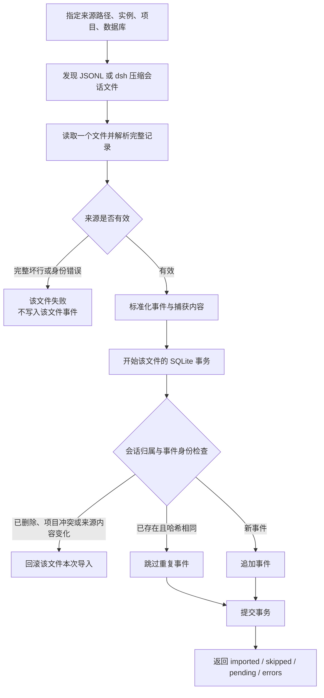
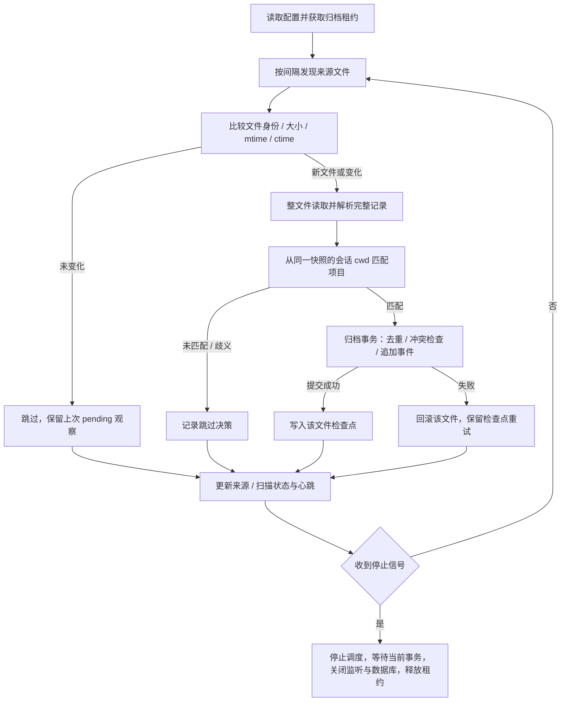

# Agent Trace 内部架构

Agent Trace 读取宿主已经写入的 Codex、pi 与 DeepSeek Harness（`dsh`）会话日志，标准化为事件并写入本地 SQLite。归档通过 CLI 批次文件或本机只读 API 提供 `metadata` / `content` 视图。Trace 不安装 hook、不调用模型、不重新执行日志中的工具，也不保存下游投递状态或消费游标。

## 组件与源码位置

下表的 `src/` 路径相对于 Trace 源码目录；npm 发行包提供编译后的 `dist/`。

| 组件 | 源码 | 职责 |
| --- | --- | --- |
| 命令入口 | `src/cli.ts` | 参数校验、命令编排、导入回执、私有批次文件输出 |
| 数据类型与基础校验 | `src/types.ts` | 事件 / 批次类型、身份、时间、哈希和错误 |
| 日志适配器 | `src/codex.ts`、`src/pi.ts`、`src/dsh.ts` | 将原生记录映射为统一事件；dsh 支持拼接 Zstandard 帧与子会话归属 |
| 来源与归档存储 | `src/store.ts` | 文件发现、大小检查、事务写入、去重、分页、删除与 blob 回收 |
| 服务配置 | `src/config.ts` | 严格配置校验、路径解析、项目规则、默认库兼容 |
| 本机 API | `src/api.ts`、`src/server.ts` | 查询与授权校验、回环监听、错误与状态信封、分页和响应大小上限 |
| 采集调度与服务 | `src/collector.ts`、`src/service.ts` | 来源发现、cwd 匹配、扫描检查点、租约与心跳、生命周期与优雅关闭 |
| 投影版本 | `src/projection.ts` | 定义 `PROJECTION_VERSION`，阻止不同归一化语义混写 |
| 会话标题 | `src/titles.ts` | 从 Codex / dsh 索引读取会话显示名快照 |

适配器与存储在同一包内协作，没有插件装载框架。新增运行时适配器沿用公共事件信封、身份规则与版本校验。

## 采集与归档流程

未结束的 JSONL 尾行或未写完的 dsh Zstandard 尾帧留待下次导入，已完成的前缀可以先入库。Trace 整文件重读，通过事件身份去重；源文件消失不会自动删除已保存的证据。CLI 一次选择多个文件时，每个文件独立提交；失败文件写入回执，进程以非零状态退出。修复后可重试，已提交事件会被跳过。

### 常驻扫描

`serve` 的采集器和只读 API 可以分别启用。每份[服务配置](SERVICE-CONFIG.md)对应一个数据库和一种固定的 `capture_mode`；不同数据库可以同时采集，同一数据库只允许一个采集租约。租约保存在 `collection_lease`，过期后可接管。

首次 `backfill=none` 只记录基线，之后新文件或变化文件才会整文件导入；`backfill=all` 首次即导入。导入成功的检查点只在文件归档事务提交后写入；基线和不匹配项目是显式无导入决策，记录文件版本与项目范围指纹。崩溃后允许整文件重读，不会因检查点提前而漏事件。

## 原始证据与统一事件

- `source` 记录来源路径、行号和源行哈希；`raw` 是 content 模式捕获的、已脱敏的解析对象，不能复原源行空白或编码。
- `kind` / `data` / `body` 分别提供统一类型、白名单元数据和便于使用的正文。未知记录保留为 `source.unknown`；content 模式可按事件 ID 读取已捕获的 `raw`。
- `runtime` 标识 Codex、pi、dsh 等运行时，`model` 标识模型；原生事件类型保留在 `native_type`。

## 归档存储与身份

Trace 使用 Node.js 内置 SQLite。默认文件是 `.agent-trace/trace.sqlite`；只有新默认库不存在且旧 `.agent-archive/archive.sqlite` 已存在时，才回退到旧库。显式 `--db` 优先。

| 表 | 主要内容 |
| --- | --- |
| `metadata` | 持久的 `archive_id`、捕获模式、标准化版本 |
| `sessions` | 运行时 / 实例 / 原生会话身份、固定项目归属和删除状态 |
| `events` | 自增序列、唯一事件 ID、来源哈希与事件负载 |
| `collection_lease` / `collection_sources` / `collection_files` | 单实例租约、来源基线 / 健康状态、文件扫描检查点 |

- 会话身份是 `JSON.stringify([runtime, instance_id, session_id])`，不依赖源文件路径。移动或复制文件不会改变身份。
- Codex 普通事件由会话身份和一基行号标识；同位置不同内容是来源冲突。相同内容出现在两行是两条证据；同一会话被多个 rollout 覆盖时保留一个 revision。
- pi 一个 entry 可生成多个事件，身份包含会话身份、entry id、kind 与可选工具调用 ID。
- dsh 事件身份包含会话身份、原生 `seq`（缺失时用解码后行号）、kind 与可选工具调用 ID。`record_hash` 对应逻辑 JSONL 源行。
- `archive_seq` 表示归档提交顺序，`occurred_at` 是来源报告的时间，不声明跨运行时的全局因果顺序。
- 归档记录 `normalizer_version`。与当前 `PROJECTION_VERSION` 不一致时，写入与 `serve` 以 `PROJECTION_MISMATCH` 拒绝；升级见[投影版本与归档升级](PROTOCOL.md#投影版本与归档升级)。

`delete-session` 在归档事务中清除该会话的事件、保留删除状态并追加确定性墓碑；提交后清理相关 blob。删除可以留下合法的序列空洞，不能据此判断缺页。已删除身份不接受重导；已导出的文件和备份不会自动清除。批次字段、幂等重试及删除契约以 [v1 协议](PROTOCOL.md)为准。

## 捕获与访问边界

`metadata` 是新库默认模式，只保存白名单结构、来源和最多 80 字符的请求标题，这些字段仍可能敏感。`content` 必须在建库时显式启用；导出视图无法补回未捕获的内容。正文在落库前脱敏，大字符串以 `content_ref` 指向权限受限的外置文件，详见[正文归档](CONTENT-CAPTURE.md)。

[本机只读 API](LOCAL-API.md)仅监听回环地址，要求配置的 bearer token 并校验 Host / Origin。导出与 API 都不按项目过滤；需要更窄的权限范围时应划分独立归档，而不是修改批次。Trace 不提供多用户认证、浏览器 UI、按时间删除或独立保留期策略。
