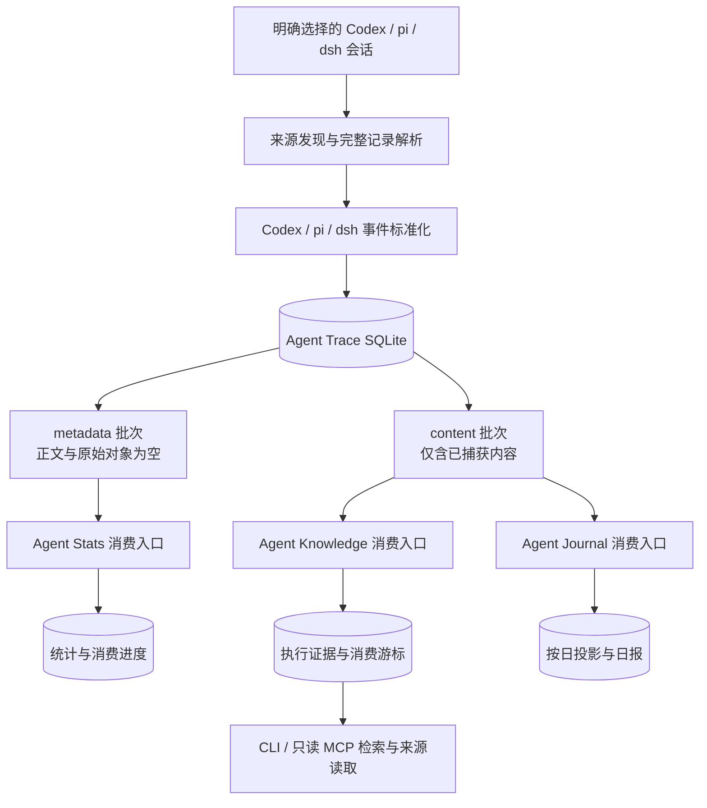
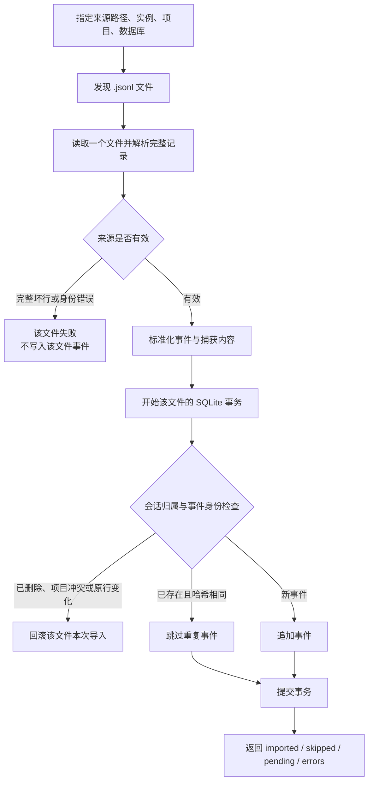
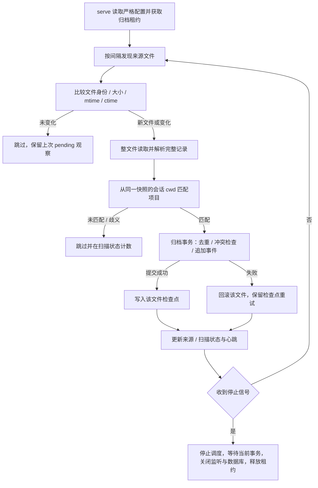
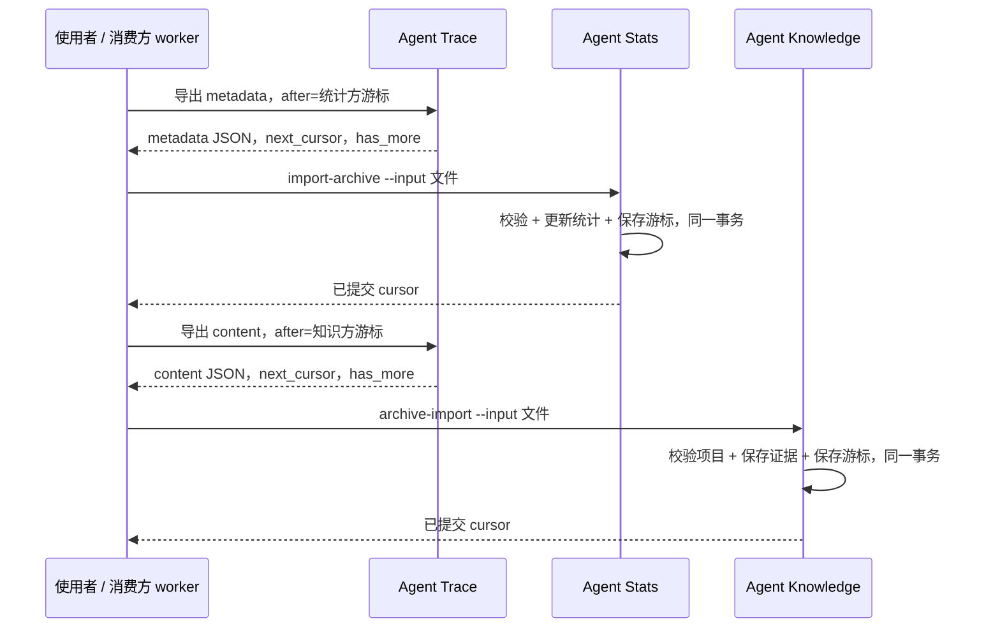
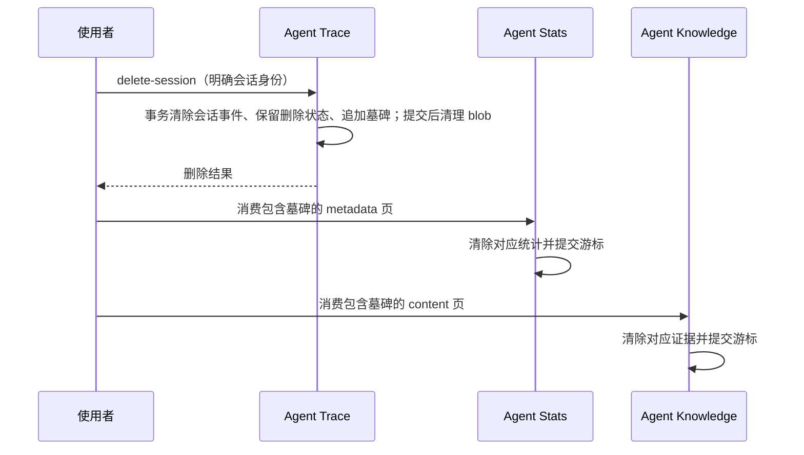

# 架构说明

Agent Trace 保存明确选定的执行证据，并把同一事件流组织成 metadata / content 两种视图供消费方独立读取。采集对象是宿主已经写入的 Codex、pi 与 DeepSeek Harness（`dsh`）会话日志；Trace 不安装 hook、不调用模型、不联网，也不重新执行日志中的工具。消费进度、重试和租约都留在各消费方，Trace 不维护下游清单、投递队列或确认游标。

## 职责与数据流

Agent Stats 生成用量统计；Agent Knowledge 维护可检索的执行证据投影；Agent Journal 按本地日生成日报。三者共享本模块的 v1 事件契约，但各自实现消费逻辑，不共享代码和内部数据库表。

数据流支持三种传输：CLI 导出 / 导入 JSON 文件、本机只读分页 API，或消费方自己的 `follow` worker 调用该 API。`serve` 可以独立采集并提供 API，但不会推送或调用下游。`config-check` 只校验常驻服务配置，不启动采集。Inspector 是独立查看工具，尚未与本模块集成。

| 项目 | 拥有的数据与规则 | 对外入口 |
| --- | --- | --- |
| Agent Trace | 捕获策略、来源、事件身份、事件证据、统一序列、删除标记 | `ingest` / `export` / `read` / `delete-session` / `status` / `config-check` / `serve` / `reingest` / `gc` |
| Agent Stats | 用量归因、费用估算、工具统计、独立消费进度 | `import-archive`、原有看板和查询、`follow` |
| Agent Knowledge | 已授权的归档证据投影、检索、来源读取、独立消费进度 | `archive-import` / `archive-search` / `archive-read`、只读 MCP、`follow` |
| Agent Journal | 按日回顾产物、cursor / 日缓冲、云模型 map / reduce 与用量记录 | `sync` / `dream` / `run` / `status` |

消费方通过版本化批次协议协作，不读写 Trace 的内部数据库。Python 与 TypeScript 共享数据契约，各自保留业务算法和存储；页面契约一致性用例见 [fixtures/protocol](../fixtures/protocol/README.md)。

## 模块与源码位置

| 模块 | 源码 | 责任 |
| --- | --- | --- |
| 命令入口 | [src/cli.ts](../src/cli.ts) | 参数校验、命令编排、导入回执、私有批次文件输出 |
| 数据类型与基础校验 | [src/types.ts](../src/types.ts) | 事件 / 批次类型、身份、时间、哈希和错误 |
| Codex 适配器 | [src/codex.ts](../src/codex.ts) | JSONL 完整行解析、原生记录到统一事件的映射、元数据白名单 |
| Pi 适配器 | [src/pi.ts](../src/pi.ts) | pi session 树到轮次 / 用量 / 工具事件的映射；按请求用量合成累计快照与记录成本 |
| Dsh 适配器 | [src/dsh.ts](../src/dsh.ts) | dsh 拼接 Zstandard 会话解码、v0 / v4 事件到轮次 / 用量 / 工具事件的映射；按 header `origin` / `parentSession` 归属子代理会话，跳过 seeded 继承前缀；记录级用量合成累计快照 |
| 来源与归档存储 | [src/store.ts](../src/store.ts) | 显式路径发现、来源大小检查、事务写入、去重、分页、高水位、读取、删除与 blob 回收 |
| 服务配置 | [src/config.ts](../src/config.ts) | 严格配置校验、相对路径解析、项目 / cwd 匹配、默认库兼容 |
| 本机 API 契约 | [src/api.ts](../src/api.ts) | 查询与授权校验、错误映射、状态信封、页大小边界 |
| 收集调度 | [src/collector.ts](../src/collector.ts) | 来源发现、项目 / cwd 匹配、基线 / 变化文件重读、单实例租约 / 心跳、扫描状态 |
| 本机 API 服务端 | [src/server.ts](../src/server.ts) | 回环监听、路由、认证 / 视图校验、复用 `exportBatch`、二进制页上限 |
| 服务编排 | [src/service.ts](../src/service.ts) | 采集与 API 生命周期、启动 / 扫描 / 停止事件、优雅关闭 |
| 投影版本 | [src/projection.ts](../src/projection.ts) | `PROJECTION_VERSION`，用于阻止不同语义的归档混合写入 |
| 会话标题读取 | [src/titles.ts](../src/titles.ts) | 从 Codex / dsh 索引读取会话显示名快照 |
| 跨项目验收 | [scripts/verify-consumers.ts](../scripts/verify-consumers.ts)、[scripts/verify-follow.ts](../scripts/verify-follow.ts) | 用临时目录、回环端口与合成数据调用真实 CLI / 服务 |
| 统计消费方 | [agent_stats/archive.py](../../agent-stats/agent_stats/archive.py) | 批次校验、事务游标、统计重建与删除传播 |
| 证据消费方 | [src/archive/index.ts](../../agent-knowledge/src/archive/index.ts) | 事务导入、owner / project 范围、证据搜索和读取 |

适配器与存储直接在同一个本地包内协作，没有插件装载框架。新增运行时适配器时沿用公共事件信封、身份规则和消费契约。

## 常驻进程与数据边界

一个 Trace 配置只对应一个归档数据库和一种捕获模式，因此常见运行形态是多个独立角色，而不是重复服务：

| 角色 | 数据边界 | 说明 |
| --- | --- | --- |
| Trace metadata `serve` | metadata SQLite | 采集结构、标题、路径和用量，供 Stats 统计 |
| Trace content `serve` | 独立 content SQLite + blob | 只采集明确项目的正文，供 Knowledge、Journal 与按需正文查看 |
| Stats `follow` | Stats SQLite | 唯一的 metadata 写入者，维护游标和租约 |
| Stats 看板 `serve` | Stats SQLite，按需只读 content | 只读 HTTP 看板，不采集、不推进游标 |
| Knowledge `follow` | Knowledge 证据 SQLite | 唯一的 content 证据写入者；CLI / MCP 按需读取 |
| Journal 批处理 | Journal SQLite + 日报目录 | 由 Journal 自己的定时任务触发，按日拉取 content 增量并生成日报；Trace 不运行 Journal 命令，也不管理其游标 |

拆分原因：

- `capture_mode` 在数据库创建后固定，metadata 与 content 必须使用不同数据库、不同 API 端口 / token 和不同项目范围，可以分别启停、审计和重建。
- metadata 范围可以较宽，但只有结构、标题、路径和用量；content 保存请求、回答、工具参数 / 输出和可见推理，必须限定明确项目。Stats 只消费 metadata，正文不会写入统计库。
- Stats 的 `follow` 与看板分离：worker 独占写入和同步租约，看板只读。看板重启不丢游标，worker 也能在不打开看板时独立运行。
- Knowledge 没有常驻看板，只运行 content `follow`；CLI / MCP 按需读取证据库。
- 不同数据库的采集进程可以同时运行；同一归档数据库只允许一个采集租约。

## 采集与归档流程

没有换行结束的尾行被视为未完成，已完成的前缀可以先入库，下一次导入原文件时再接收完整尾行。当前会重读选定文件，通过事件身份去重；源文件消失不会自动删除已保存证据。一次 CLI 可指定多个来源，某文件失败不回滚之前成功的文件；回执列出失败文件，进程以非零状态退出。修复后可重复导入所有同来源文件，已提交事件会被跳过。

常驻扫描的流程：

首次 `backfill=none` 只记录当前文件的基线身份，不导入既有事件；之后新文件或变化文件整文件导入。`backfill=all` 首次即导入。扫描检查点按来源文件身份记录：导入成功的检查点只在该文件归档事务提交后写入；基线和不匹配项目是显式的无导入决策，记录文件版本与项目范围指纹，配置修正后会重试。崩溃后允许整文件重读，不会因检查点提前而漏事件。单归档采集租约保存在 `collection_lease`，第二个采集实例被拒绝，过期租约可接管。

## 消费方分页与重试

各消费方从各自的零游标开始，页大小可以不同。只有消费成功回执中的 `cursor` 才能作为该消费方的下一次 `--after`。`has_more=true` 时继续取页；为 `false` 时，本次可见前缀已读完，后续导入新事件后再取。metadata 与 content 共用同一归档序列空间，但不能把一方游标当作另一方进度，也不能在已有消费状态中随意切换视图。`follow` worker 的请求、校验与提交规则见[消费方 follow 约定](consumer-follow.md)。

| 情况 | 当前行为 | 操作 |
| --- | --- | --- |
| 源会话持续追加 | 已存在前缀跳过，新完整行入库 | 再运行同一 `ingest`，或等待常驻扫描 |
| 导出完成、消费前中断 | 消费方游标未前进 | 提交原导出文件 |
| 消费成功、回执未保存 | 事件和游标已一同提交 | 重试原成功页，读取返回的当前游标 |
| 同一完整页再次提交 | 指纹一致则幂等返回 | 可直接重试 |
| 跳过页或提交向前重叠页 | 拒绝且不推进游标 | 从已确认游标重新导出 |
| 同页身份内容变化 | 拒绝且不推进游标 | 保留原文件，核对来源与导出过程 |
| Agent Knowledge 页中有未授权项目 | 整页拒绝 | 核对本机授权或拆分归档范围，勿手工删事件保留游标 |

导出文件是独立快照。源删除操作发生后，重新导出同一早期范围可能与旧页不同；恢复回执时应重试原成功页，而不是制造内容不同的“相同页”。

## 删除传播

删除和各方投影清除并非跨进程同时完成。停机的消费方在恢复并消费墓碑后清除自身数据；外部导出文件和备份不随之自动消失。删除造成序列空洞是合法情况，不能把空洞当作缺页，分页仍应使用返回的 `next_cursor`。已删除会话不能被同来源再次导入，消费方也拒绝以新事件复活它。

## 原始证据、统一事件与投影

一个归档事件包含三个层次：

1. `source` 和 `raw`：来源路径、行号、原行哈希，以及 content 模式捕获的解析对象（已脱敏并可能外置大字符串）。没有保存可独立复原原始空白 / 编码的完整行字节。
2. `kind` / `data` / `body`：统一类型、白名单元数据和便于使用的正文。未知记录保留为 `source.unknown`；content 模式下仍可按事件 ID 读取 `raw`，但其内容不一定进入 Agent Knowledge 的正文检索。
3. 消费方投影：统计结果或可搜索的执行证据。投影可从可用的归档事件重新构建，不能代替归档捕获范围之外的原始资料。

`runtime` 标识 Codex、pi、dsh 等运行时，`model` 标识模型；事件原生类型仍保留在 `native_type`。当前不是面向所有运行时的完整模型调用审计系统。

## 归档存储

使用 Node.js 内置 SQLite。新默认数据文件为 `.agent-trace/trace.sqlite`；只有新默认库不存在且旧 `.agent-archive/archive.sqlite` 已存在时，才回退到旧库。显式 `--db` 优先。

| 表 | 主要内容 |
| --- | --- |
| `metadata` | 持久的 `archive_id`、捕获模式、标准化版本 |
| `sessions` | 运行时 / 实例 / 原生会话身份、固定项目归属和删除状态 |
| `events` | 自增序列、唯一事件 ID、来源哈希与事件负载 |
| `collection_lease` / `collection_sources` / `collection_files` | 单实例租约、来源基线 / 健康状态、文件扫描检查点（不改变事件协议） |

一个文件的事件在同一写事务内提交；CLI 一次选择多个文件时，每个文件独立提交。正常导入是追加式写入，显式删除是清除证据、追加删除标记并清理 blob 的例外。文件使用本机私有权限；不提供多用户认证。

Agent Stats 的消费表放在其现有统计库内。Agent Knowledge 的归档证据放在 `<知识库文件>.archive-evidence.sqlite`，与现有知识库分开，避免同步归档导入阻塞同进程异步知识事务。操作方法见[使用说明](usage.md)。

## 身份与一致性

- 会话身份是 `JSON.stringify([runtime, instance_id, session_id])`，不依赖源文件路径。文件移动或复制后仍能去重。
- Codex 普通事件身份由会话身份和原文件一基行号生成；同位置不同内容视为来源冲突，整文件本次导入回滚。同内容出现在两行是两条证据；同一会话被多个 rollout 覆盖时保留一个 revision。
- pi 一个 entry 可产生多个事件，身份由会话身份、entry id、kind 与工具调用 id 生成，不依赖行号；副本和移动保持身份。
- dsh 事件身份由会话身份、原生 `seq`（缺失时用解码后行号）、kind 与可选的工具调用 id 生成；一行可产生多个 kind，不会互相覆盖。解码后的行号与 `record_hash` 描述逻辑 JSONL 追加顺序。
- `archive_seq` 表示归档提交顺序；`occurred_at` 表示来源报告时间。没有按时间重排全局事件，也不声明不同运行时的全局因果顺序。
- 每个消费方按 `archive_id` 保存自己的游标，并将事件处理结果和游标原子提交。完整旧页允许重试，跳页和向前延伸的重叠页拒绝。
- 删除标记有专用确定性 ID。消费方校验身份后清除对应投影并记录删除状态，旧页合法重试不会恢复已删除数据。
- 归档记录 `normalizer_version`；当前构建的 `PROJECTION_VERSION` 与之不一致时，写入、`delete-session`、`ingest`、`reingest` 和 `serve` 都以 `PROJECTION_MISMATCH` 拒绝，必须按[协议](protocol.md#投影版本与归档升级)重建新归档和消费方库。

事件字段及边界以 [v1 协议](protocol.md) 为准。

## 捕获与访问边界

`metadata` 是新库默认捕获模式，只保存白名单结构、来源和最多 80 字符的请求标题；这些字段仍可能敏感。`content` 必须在建库时显式启用，才会保存正文和解析对象。模式固定，导出 content 不能补回未捕获的内容。

content 事件在进入归档事务前统一脱敏：常见凭据形态、敏感键值和标题被替换为显式 `[REDACTED:<类别>]`；超过 `content.max_inline_bytes` 的字符串不截断，而是写入权限受限的外置目录，并以带 `bytes` / `sha256` 的 `content_ref` 替换。`record_hash` 仍指向原始源行。外置文件随会话删除或 revision 替换清理；进程被强杀可能留下无引用文件，可用 `gc` 回收。详见[正文归档](content-capture.md)。

Agent Stats 仅接收 metadata 视图。Agent Knowledge 与 Agent Journal 接收 content 视图，并按各自配置执行项目范围限制；历史正文始终是待核实证据。当前导出流和 API 不做按项目过滤，越权项目会被 Knowledge 整页拒绝；窄范围部署使用独立归档。API 只监听回环地址，每个请求必须携带配置中声明的 bearer token，并校验 Host / Origin，详见[本机只读 API](local-api.md)。

脱敏是启发式保护，不能保证自由散文或私有格式中的密钥不被保存，也不能恢复隐藏推理。删除传播依赖各消费方继续取页；既有导出文件、备份、外置 blob 及其他副本需分别处理。

## 当前范围与已知限制

已实现：Codex / pi / dsh 适配器、metadata / content 捕获、严格服务配置、前台 `serve`、来源扫描调度、单归档租约 / 心跳、`GET /v1/events`、`GET /v1/status`、`gc`、`reingest`，以及 Stats / Knowledge 的 follow 自动拉取。

尚未实现或未验证：

- 按项目过滤的事件流；当前授权要求消费方能读取整页所有项目。
- 多用户认证、非回环监听、浏览器前端和 Inspector UI 集成。
- 长期真实宿主运行、真实网络故障 / 超时矩阵、跨机部署和大规模日志吞吐。
- 按时间删除事件和独立保留期策略；自动经验提取也不在范围内。
